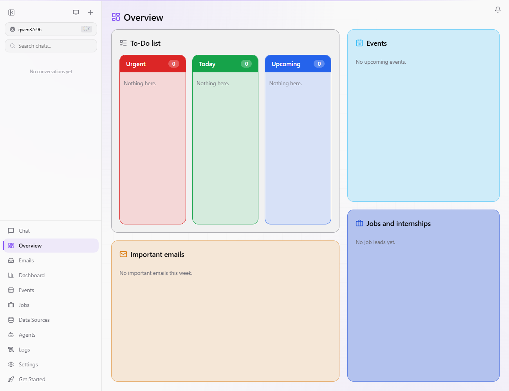

# OpenJarvis Personal Add-ons

Add-ons for [OpenJarvis](https://github.com/open-jarvis/OpenJarvis), the on-device AI assistant. They turn it into a personal assistant that reads your email, finds events and job openings, and drafts applications, all on your own computer with your local model.

Once installed, **everything is set up in the web UI**. The terminal is only needed to install OpenJarvis and these add-ons.



## What you get

**Email**
- **Settings › Email accounts:** connect one or more Gmail accounts with an app password. The login is checked before it is saved, and passwords stay on your computer.
- **Inbox triage** every 15 minutes: flags emails that need your attention and pulls out deadlines.
- **Event Mate:** turns event emails (workshops, meetups, info sessions) into a list of events scored against your preferences.
- **Emails** and **Events** pages, and an **Overview** page with your to-dos, deadlines, events and job leads.

**Job search**
- A daily search for jobs and internships using your own search terms.
- Each posting gets a fit score (0–100) based on your profile: who can apply, the fields you want, your skills and location.
- For the best matches it drafts a tailored resume and cover letter. It only uses facts from your resume, flags any number it can't find there, and **never submits anything**.
- An optional helper opens an application in a browser and fills in your name, email, phone and documents, then leaves the window open for you to check and submit.
- A **Jobs** page with the details and drafts for each posting.

**Theme**
- Pick an accent colour, upload a background image and adjust how faded it is.

## Install

You need a working OpenJarvis install from git (its `src` folder), plus [uv](https://docs.astral.sh/uv/) and Node.js 22.

**Windows** (PowerShell):

```powershell
git clone https://github.com/TronJuan/openjarvis-personal-addons
cd openjarvis-personal-addons
.\install.ps1
```

The script finds OpenJarvis in `%LOCALAPPDATA%\OpenJarvis\src` or `~\.openjarvis\src` (or pass `-Source <path>`). It applies the patches, installs `python-docx` and Playwright, rebuilds the web UI, and schedules Event Mate every 15 minutes and the job search daily at 8:00 in Task Scheduler (skip that with `-NoSchedule`).

**macOS / Linux:**

```bash
git clone https://github.com/TronJuan/openjarvis-personal-addons
cd openjarvis-personal-addons
./install.sh            # or: ./install.sh /path/to/OpenJarvis
```

It prints the two `crontab` lines to run the agents on a schedule.

Then restart `jarvis serve` and open the web UI.

## Set it up in the UI

1. **Settings › Email accounts:** turn on 2-Step Verification for your Google account, create an app password at [myaccount.google.com/apppasswords](https://myaccount.google.com/apppasswords), and add the account.
2. **Settings › Personal agents:**
   - Fill in your profile. "Who you can apply as" matters most for the fit score (e.g. your graduation date and work rights).
   - Paste your resume as Markdown. The agent only rewrites a `### Profile` section and reorders entries in a section whose heading contains "Projects".
   - Edit the job searches, and add phrases that should rule a posting out (e.g. `2026/27`, `security clearance`).
   - Adjust your event preferences and which senders or keywords Event Mate checks.
   - Press **Run now** on either agent to try it straight away.
3. **Settings › Appearance:** pick an accent colour and background.

## Privacy

- Email is fetched over IMAP straight to your computer and processed by your local model.
- The job search sends only your search terms to OpenJarvis's web search tool. Your resume and profile never leave your computer.
- Drafts are saved in the OpenJarvis data folder (`personal/drafts`), unless you set another folder.

## Compatibility

The patches were tested against OpenJarvis commit [`792131fe`](https://github.com/open-jarvis/OpenJarvis/commit/792131fe) (October 2026) on Windows 11. That includes 69 automated tests (56 in `tests/personal`, 13 for the Gmail connector and `jarvis connect`), a type-checked UI build, and a fresh-install run-through. Upstream's own connector suite has 9 failures on Windows (Apple Calendar and live-account tests), with or without these patches. `install.sh` has not been tested on macOS or Linux yet.

If OpenJarvis has changed too much for the patches to apply, the installer stops without changing anything. Check out the tested commit first:

```bash
git -C ~/.openjarvis/src checkout 792131fe
```

To remove the add-ons, reset your OpenJarvis checkout to the commit before them (`git reset --hard HEAD~2`) and delete the two scheduled tasks under `\OpenJarvis\`.

## Licence

Apache 2.0, the same as OpenJarvis. This is an independent project, not an official OpenJarvis release.
